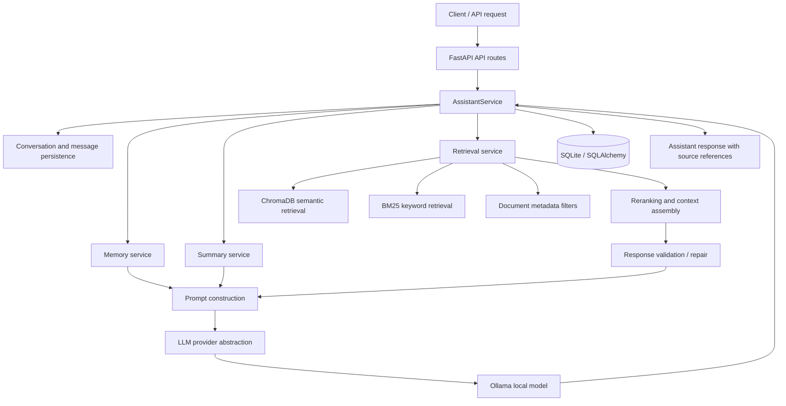
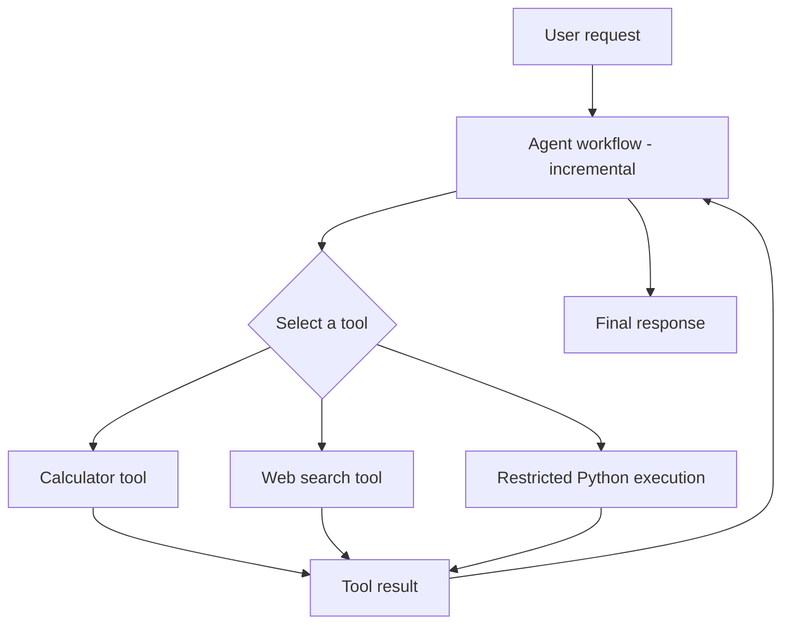

# AI Website Assistant

An extensible, memory-aware AI website assistant built around a modular FastAPI backend, local LLM inference with Ollama, persistent conversation storage, and a Retrieval-Augmented Generation (RAG) pipeline. The project is being developed incrementally so that the initial chatbot can evolve into a tool-using agent and, where needed, a multi-agent system without requiring a complete rewrite.

> **Documentation scope:** This README documents Phases 1–4 and adds a living **Phase 5 roadmap**. Phase 5.1 (Assistant Configuration API) is recorded as implemented in the project discussion, while its end-to-end verification is still marked pending because the supplied discussion ends with the instruction to run the five API checks. The embeddable website widget and other follow-up items remain planned until implementation and verification are recorded.

---


## Table of Contents

- [Project Overview](#project-overview)
- [Goals and Design Principles](#goals-and-design-principles)
- [Development Phases](#development-phases)
- [Phase 5 Roadmap and Progress](#phase-5-roadmap-and-progress)
- [Implemented Capabilities](#implemented-capabilities)
- [Technology Stack](#technology-stack)
- [System Architecture](#system-architecture)
- [Backend Structure](#backend-structure)
- [Core Workflows](#core-workflows)
- [API Overview](#api-overview)
- [Configuration](#configuration)
- [Local Development Setup](#local-development-setup)
- [Running the Application](#running-the-application)
- [Testing and Quality Checks](#testing-and-quality-checks)
- [Observability and Monitoring](#observability-and-monitoring)
- [Agent Tools and Execution Safety](#agent-tools-and-execution-safety)
- [Database and Migrations](#database-and-migrations)
- [Known Limitations and Follow-up Work](#known-limitations-and-follow-up-work)
- [Development Conventions](#development-conventions)

---


## Project Overview

AI Website Assistant starts as a conventional conversational assistant and grows through distinct engineering phases:

1. **Foundation:** establish a maintainable backend, configuration, logging, database access, and API conventions.
2. **Memory:** retain conversation history, summarize older context, extract durable user facts, and retrieve relevant memories.
3. **RAG:** ingest documents, split them into chunks, create embeddings, retrieve relevant evidence, and generate source-grounded answers.
4. **Agent/tool foundation:** introduce reusable tools, including calculator, web search, and restricted Python execution.

The initial target is a chatbot that answers questions using the LLM and a knowledge base. Agent planning and multi-agent orchestration are later extensions; they should build on the existing provider, memory, retrieval, and tool abstractions.

## Goals and Design Principles

- **Incremental delivery:** implement and verify one feature at a time.
- **Production-oriented structure:** separate API routes, services, schemas, models, providers, and infrastructure concerns.
- **Provider independence:** isolate the LLM behind a common interface so providers can be changed without rewriting application logic.
- **Persistence:** store conversations, messages, summaries, memories, documents, and chunks in a database.
- **Evidence-grounded answers:** use retrieved document context and citations instead of allowing the assistant to invent sources.
- **Replaceable infrastructure:** keep embedding, vector storage, retrieval, caching, and LLM integrations behind dedicated components.
- **Test-first verification:** use pytest and API-level tests rather than relying only on manual REPL checks.
- **Security-conscious tool execution:** restrict the initial Python execution tool and explicitly treat it as a development-stage boundary, not a hardened sandbox.

---


## Development Phases


### Phase 1 — Foundation and Chatbot Backend

The foundation phase established the repository and a working FastAPI chatbot backend.

Implemented foundation work includes:

- Python 3.12 project managed with `uv`.
- Backend `src/` package layout.
- FastAPI application and versioned API routing.
- Centralized settings using `pydantic-settings` and environment files.
- Centralized application logging with Loguru.
- Request logging middleware.
- Standard API response schema and global exception handling.
- Health endpoint and Swagger/OpenAPI documentation.
- Pydantic chat request/response schemas.
- Provider abstraction and provider factory.
- Ollama provider using `httpx` to communicate with the local Ollama HTTP API.
- Assistant service separating business logic from HTTP routes.
- SQLite/SQLAlchemy async database foundation.
- Conversation and message models.
- Database session dependency and persistence services.
- Chat endpoint connected to the assistant service and Ollama.

The development model used in the recorded implementation was `llama3.2:3b`. `qwen3:8b` was also tested locally. The selected model is configurable through environment variables.

### Phase 2 — Conversation and Semantic Memory

Phase 2 added persistent conversational context and retrieval of useful information from earlier messages.

Implemented capabilities include:

- Conversation creation and message persistence.
- Conversation listing and history retrieval.
- A bounded recent-history window (`MAX_HISTORY`) to limit prompt growth.
- Conversation summaries to compress older messages.
- Summary retrieval and injection into the assistant prompt.
- A persistent memory model and memory service.
- Semantic embeddings using Sentence Transformers (`all-MiniLM-L6-v2`).
- Cosine-similarity-based memory retrieval.
- Top-k memory selection.
- Durable-fact extraction so greetings and ordinary small talk are not intended to become permanent memories.
- Duplicate-memory checks.
- Reuse/caching of the embedding model to avoid repeatedly loading it.

The intended prompt context combines three sources:

1. Long-term conversation summary.
2. Relevant semantic memories.
3. Recent conversation messages.

The assistant is instructed to use these sources naturally rather than exposing internal memory or summary mechanics to the user.

### Phase 3 — Retrieval-Augmented Generation (RAG)

Phase 3 extended the assistant with document ingestion and evidence retrieval.

#### Document ingestion

- Document upload endpoint and file persistence.
- Text extraction for PDF, DOCX, and plain-text documents.
- Document records and metadata such as filename, file type, category, owner, and tags.
- Chunking with overlap to preserve context across chunk boundaries.
- Chunk records associated with their source documents.
- Embedding generation using the shared Sentence Transformers embedder.
- Vector storage in ChromaDB, while retaining relational metadata and chunk records in SQLite/SQLAlchemy.


#### Retrieval pipeline

The RAG implementation evolved to include:

- Semantic vector retrieval.
- BM25 keyword retrieval.
- Hybrid retrieval combining semantic and keyword candidates.
- Metadata filtering by category and owner.
- Candidate deduplication.
- Reranking to select a smaller set of relevant chunks.
- Query expansion and query rewriting services.
- Self-RAG evaluation/retry logic.
- Retrieval context construction with source filename and chunk index.
- Source/citation text added to answers when relevant evidence is retrieved.
- Response validation against retrieved context.
- Response repair when the generated answer is not sufficiently supported.
- An explicit fallback when the required information cannot be found in retrieved documents.

The intended grounding rule is strict: cite only retrieved chunks, do not fabricate citations, and clearly state when the indexed documents do not contain the requested information.

#### Caching and performance work

The conversation records the following optimization components:

- Embedding cache with normalized text keys.
- Singleton/shared embedder access.
- Query expansion cache.
- Prompt cache.
- Retrieval cache.
- Response cache.
- Original-query embedding reuse where appropriate.
- Batch embedding support and related query-service optimization work.

Cache keys for retrieval/response operations need to include relevant metadata filters (such as category and owner), not just the query text, to avoid reusing results across different document scopes.

#### Parent-document retrieval

Parent-document support was introduced as a retrieval architecture extension. The intended design is for the retrieval layer to expand retrieved child chunks to their parent documents and return a structured retrieval result. Parent-document retrieval should remain inside the retrieval subsystem rather than adding more document/vector-search responsibilities to `AssistantService`.

The conversation also records a SQLite migration issue involving timestamp defaults when adding columns to existing tables. Treat the migration as an area requiring environment-specific verification rather than assuming every migration ran successfully.

#### RAG observability and operational support

The Phase 3 work also includes:

- Request and LLM timing metrics.
- Provider statistics.
- Cache analytics.
- Retrieval analytics.
- Conversation analytics.
- Token-usage tracking through the provider abstraction (providers that do not report usage return zero values).
- Structured JSON logging.
- Request IDs and `X-Request-ID` propagation.
- Contextual/structured exception logging.
- Provider, retrieval, reranker, Self-RAG, and cache event logging.
- Health and readiness checks.
- Monitoring/statistics endpoints.
- A dashboard service that assembles request, provider, cache, retrieval, and conversation metrics.

The conversation shows successful requests to `/api/v1/health`, `/api/v1/ready`, and `/api/v1/dashboard` during local verification.

### Phase 4 — Agent and Tool Foundation

Phase 4 begins extending the assistant beyond question answering by introducing tools that can be invoked by an agent workflow.

The project structure and tool exports recorded in the conversation include:

- `CalculatorTool`
- `WebSearchTool`
- `PythonExecutionTool`


#### Restricted Python execution tool

The Python execution tool is implemented as a conservative first version. Its documented design includes:

- Execution in a separate subprocess.
- A temporary working directory.
- A timeout (default 5 seconds, maximum 10 seconds).
- Restricted environment variables.
- Captured standard output and standard error.
- Output-size and code-size limits.
- AST validation.
- Blocking imports and selected dangerous built-ins such as `eval`, `exec`, `compile`, `__import__`, and `open`.
- Controlled execution errors.

The tool is exported through the agents/tools package and has pytest coverage for basic execution, multiple output lines, and invalid Python syntax. The conversation records the tool tests as completed.

**Important security limitation:** this subprocess-based implementation is not a production-grade security sandbox. The project discussion explicitly defers hardened isolation to a later Docker/container execution boundary. Do not expose arbitrary code execution to untrusted users in a production deployment based only on the current restrictions.

> The original high-level roadmap describes multi-agent routing (for example, Sales, Support, HR, Documentation, and Billing specialists). The available implementation record through this README's scope confirms the tool foundation, but does not establish that a complete multi-agent orchestrator and all specialist agents have been finished. They are therefore not claimed as completed here.

---


## Phase 5 Roadmap and Progress

Phase 5 moves the backend toward a configurable assistant that can be deployed on a website. The earlier high-level project roadmap labels Phase 5 as the **Embeddable Widget**. The latest implementation notes in the project conversation first record **Phase 5.1 — Assistant Configuration API**. This section keeps those source-backed details together and leaves the remaining work as a checklist so progress can be updated as development continues.

### Phase 5.1 — Assistant Configuration API

**Implementation status:** recorded as complete.  
**Verification status:** end-to-end checks pending.

The project discussion explicitly records this feature as implemented, including its database model, migration, schemas, service layer, and API routes. The discussion then asks for the endpoints to be tested against the local database; it does not include the results of those five checks.

#### Configuration fields shown in the recorded API example

The create request in the project notes uses the following fields:


| Field             | Example / purpose shown in the notes |
| ----------------- | ------------------------------------ |
| `name`            | `My Test Assistant`                  |
| `system_prompt`   | Assistant behavior instructions      |
| `llm_provider`    | `ollama`                             |
| `llm_model`       | `llama3.2:3b`                        |
| `temperature`     | `0.2`                                |
| `max_tokens`      | `1024`                               |
| `welcome_message` | `Hi! How can I help?`                |
| `primary_color`   | `#2563EB`                            |
| `is_active`       | `true`                               |


Use the live Pydantic schemas and Swagger/OpenAPI specification as the source of truth for the complete field list, validation rules, defaults, and response shape. The table above reproduces only the fields visible in the recorded example; it is not intended to replace the schema.

#### Recorded API routes


| Operation             | Method and route                                 | Expected result in the recorded test plan          |
| --------------------- | ------------------------------------------------ | -------------------------------------------------- |
| Create configuration  | `POST /api/v1/assistant-configs`                 | `201 Created`; copy the returned UUID              |
| Get one configuration | `GET /api/v1/assistant-configs/{config_uuid}`    | `200 OK`                                           |
| Update configuration  | `PATCH /api/v1/assistant-configs/{config_uuid}`  | `200 OK`; example updates `name` and `temperature` |
| List configurations   | `GET /api/v1/assistant-configs`                  | `200 OK`                                           |
| Delete configuration  | `DELETE /api/v1/assistant-configs/{config_uuid}` | `204 No Content`                                   |


#### Local end-to-end verification checklist

Run the backend from the `backend/` directory:

```bash
uv run uvicorn app.main:app --reload
```

Open Swagger UI at `http://127.0.0.1:8000/docs`, locate **Assistant Configurations**, and execute the requests in this order:

- [ ] Create a configuration with the example payload and save its returned UUID.
- [ ] Fetch that configuration by UUID and confirm the stored values.
- [ ] Patch the name and temperature; confirm only the intended values change.
- [ ] List configurations and confirm the created record is present.
- [ ] Delete the configuration and confirm the `204 No Content` response.
- [ ] Run the relevant automated tests and the full backend test suite.
- [ ] Record the actual test command, pass count, and any migration/database issues here.

**Known limitations explicitly noted alongside Phase 5.1:** the routes return raw JSON rather than a standardized response envelope, and they do not yet enforce authentication or website ownership. These are follow-up requirements before the configuration API is considered production-ready.

### Embeddable Website Chat Widget (planned)

The initial project roadmap identifies an embeddable widget as the Phase 5 product-facing milestone. Its stated goal is to let a website owner add the assistant to a website without rebuilding the existing backend. The following items come from the initial widget plan and should be treated as planned scope, not completed functionality.

#### Widget experience from the original plan

- [ ] Floating launcher button on the host website.
- [ ] Expandable chat panel connected to the assistant backend.
- [ ] Typing/loading animation while the assistant is responding.
- [ ] Markdown rendering for assistant messages.
- [ ] Code syntax highlighting for code responses.
- [ ] Responsive behavior suitable for desktop and mobile screens.
- [ ] File upload support (the original notes explicitly describe this as a later addition).


#### Integration and configuration work to plan

The project notes establish assistant configurations and a website widget as the direction, but do not define a final embed contract. Before implementing the widget, settle and document these items against the actual backend design:

- [ ] Define how a website identifies its assistant configuration (for example, a public widget/configuration identifier).
- [ ] Define a minimal, versioned widget bootstrap or embed script.
- [ ] Define the public runtime endpoint(s) the widget calls; do not expose administrative configuration operations to anonymous browser clients.
- [ ] Define allowed website origins and enforce origin/website ownership on the server.
- [ ] Decide how the widget receives only the public settings it needs, such as welcome text and theme color.
- [ ] Connect widget messages to the existing conversation/session persistence model.
- [ ] Define error, offline, rate-limit, and retry states.
- [ ] Add integration tests for the embed flow and browser-level tests for the widget.
- [ ] Document the installation snippet and test it on a separate sample website.


### Phase 5 follow-up backlog — security and production readiness

These requirements are supported by the limitations called out in the Phase 5.1 notes and should be completed before exposing configuration management or the widget to public websites:

- [ ] Add authentication/authorization for administrative configuration operations.
- [ ] Enforce website ownership so one customer cannot read, update, list, or delete another customer's assistant configurations.
- [ ] Separate public widget configuration/runtime access from privileged management APIs.
- [ ] Replace or formally standardize raw JSON responses if the API-wide response envelope is the chosen project convention.
- [ ] Add validation and tests for invalid UUIDs, missing records, duplicate names/identifiers (if uniqueness is required), and invalid configuration values.
- [ ] Review migration behavior on both a fresh database and an existing database.
- [ ] Add rate limiting, abuse controls, and production-safe CORS/origin policy to public widget endpoints.
- [ ] Review secret handling so provider credentials are never returned to the browser.


### Phase 5 completion criteria

Do not mark Phase 5 complete until the configuration API has passing automated and end-to-end tests, the widget can be embedded on a separate website, conversations work through that widget, and authentication/website ownership boundaries have been verified. Update the checkboxes and status labels only after the corresponding implementation and tests actually pass.

---


## Implemented Capabilities


| Area                      | Capability                                                          | Status recorded in project discussion                           |
| ------------------------- | ------------------------------------------------------------------- | --------------------------------------------------------------- |
| Backend                   | FastAPI application, versioned routes, configuration, logging       | Implemented                                                     |
| LLM                       | Provider abstraction and Ollama integration                         | Implemented                                                     |
| Chat                      | Chat endpoint and assistant service                                 | Implemented                                                     |
| Database                  | Async SQLAlchemy setup, conversations, messages                     | Implemented                                                     |
| Memory                    | Recent history, summaries, persistent semantic memories             | Implemented                                                     |
| Embeddings                | Sentence Transformers `all-MiniLM-L6-v2`                            | Implemented                                                     |
| Documents                 | Upload, extraction, metadata, chunk persistence                     | Implemented                                                     |
| RAG                       | ChromaDB, semantic retrieval, BM25, hybrid retrieval                | Implemented                                                     |
| Retrieval quality         | Reranking, query expansion/rewrite, Self-RAG                        | Implemented in the evolving pipeline                            |
| Grounding                 | Source metadata/citations, validation and repair                    | Implemented in the evolving pipeline                            |
| Performance               | Embedding/query/prompt/retrieval/response caching                   | Implemented in the evolving pipeline                            |
| Observability             | Metrics, request IDs, structured logs, health and dashboard support | Implemented in the recorded milestones                          |
| Agent tools               | Calculator, web search, restricted Python execution                 | Tool modules/exports recorded                                   |
| Assistant configuration   | CRUD API, database model/migration, schemas and service layer       | Implementation recorded in Phase 5.1; end-to-end checks pending |
| Embeddable website widget | Floating launcher, chat panel, markdown/code rendering              | Planned; not confirmed implemented                              |
| Multi-agent orchestration | Specialist-agent routing and orchestration                          | Future work; not confirmed complete                             |
| Production code sandbox   | Isolated container execution                                        | Future work                                                     |


---


## Technology Stack


| Layer                         | Technology                                          |
| ----------------------------- | --------------------------------------------------- |
| Language                      | Python 3.12                                         |
| Backend framework             | FastAPI                                             |
| ASGI server                   | Uvicorn                                             |
| Package/dependency management | `uv`                                                |
| Configuration                 | Pydantic Settings, `.env`                           |
| Validation/schemas            | Pydantic v2                                         |
| ORM/database access           | SQLAlchemy 2.x async                                |
| Local relational database     | SQLite                                              |
| Schema migrations             | Alembic                                             |
| Logging                       | Loguru and structured JSON logging                  |
| HTTP client                   | HTTPX                                               |
| Local LLM runtime             | Ollama                                              |
| Development LLM model         | `llama3.2:3b` (configurable)                        |
| Embeddings                    | Sentence Transformers                               |
| Embedding model               | `all-MiniLM-L6-v2`                                  |
| Vector database               | ChromaDB                                            |
| Keyword retrieval             | BM25                                                |
| Testing                       | pytest, pytest-asyncio, FastAPI TestClient          |
| Code quality                  | Ruff, MyPy                                          |
| Agent tools                   | Calculator, web search, restricted Python execution |


The initial repository plan also included a React + TypeScript + Vite frontend. The supplied conversation primarily documents backend implementation and Swagger/API verification; it does not provide enough final frontend implementation detail to claim a completed production chat UI.

---


## System Architecture


### Current chatbot and RAG request flow




### Agent tool direction




The diagrams show the architectural direction represented in the project discussion. They do not imply that every future planner or multi-agent orchestration feature is already complete.

---


## Backend Structure

The backend follows a `src/` layout and organizes code by responsibility. The structure below consolidates the directories and modules explicitly referenced during development; individual optional files may differ in the working tree.

```text
ai-website-assistant/
├── backend/
│   ├── src/
│   │   └── app/
│   │       ├── api/
│   │       │   ├── dependencies/
│   │       │   ├── routes/
│   │       │   │   ├── chat.py
│   │       │   │   ├── health.py
│   │       │   │   └── document.py
│   │       │   └── router.py
│   │       ├── agents/
│   │       │   ├── tools/
│   │       │   │   ├── calculator.py
│   │       │   │   ├── web_search.py
│   │       │   │   └── python_execution.py
│   │       │   └── tool.py
│   │       ├── cache/
│   │       │   ├── embedding_cache.py
│   │       │   ├── retrieval_cache.py
│   │       │   └── response_cache.py
│   │       ├── core/
│   │       │   ├── config.py
│   │       │   ├── exceptions.py
│   │       │   ├── logging.py
│   │       │   ├── logger.py
│   │       │   └── middleware.py
│   │       ├── db/
│   │       │   ├── database.py
│   │       │   ├── session.py
│   │       │   └── init_db.py
│   │       ├── embeddings/
│   │       │   ├── embedder.py
│   │       │   └── model_loader.py
│   │       ├── llm/
│   │       │   ├── base.py
│   │       │   ├── factory.py
│   │       │   └── providers/
│   │       │       ├── ollama_provider.py
│   │       │       ├── openai_provider.py
│   │       │       └── gemini_provider.py
│   │       ├── models/
│   │       ├── reranker/
│   │       ├── schemas/
│   │       ├── services/
│   │       ├── vectordb/
│   │       ├── utils/
│   │       ├── __init__.py
│   │       └── main.py
│   ├── alembic/
│   ├── tests/
│   ├── .env
│   ├── .env.example
│   ├── pyproject.toml
│   ├── pytest.ini
│   └── uv.lock
├── frontend/                 # React + TypeScript + Vite planned in the initial setup
├── docker/
├── docs/
├── scripts/
├── .github/
├── .gitignore
├── docker-compose.yml
├── LICENSE
└── README.md
```


### Responsibility boundaries

- `api/`: HTTP routes, request handling, and API dependencies.
- `core/`: configuration, logging, middleware, and exception handling.
- `db/`: database engine, sessions, and initialization.
- `models/`: SQLAlchemy database models.
- `schemas/`: Pydantic request and response models.
- `services/`: application/business logic such as assistant, conversation, memory, summary, document, chunk, retrieval, metrics, and dashboard services.
- `llm/`: provider interface, provider implementations, and provider factory.
- `embeddings/`: embedding model loading and embedding generation.
- `vectordb/`: ChromaDB client and vector operations.
- `cache/`: reusable cache components.
- `reranker/`: retrieval candidate reranking.
- `agents/tools/`: tool interface and tool implementations.
- `tests/`: unit and API-level tests.

---


## Core Workflows


### Chat request

1. Client sends a message to the chat API.
2. The route delegates to `AssistantService`.
3. A conversation is created if no conversation ID is supplied.
4. The user message is persisted.
5. Durable facts may be extracted and saved to semantic memory.
6. Recent messages and any conversation summary are loaded.
7. The RAG pipeline retrieves and reranks relevant document context.
8. Relevant semantic memories are retrieved.
9. The assistant prompt is assembled from summary, memories, recent conversation, and retrieved documents.
10. The configured LLM provider generates the response.
11. The response is validated/repaired against retrieved context where configured.
12. The assistant message is persisted and returned, with source references when applicable.


### Document ingestion

1. Client uploads a supported document.
2. The file is saved and a document record is created.
3. Text is extracted from PDF, DOCX, or TXT content.
4. Text is split into overlapping chunks.
5. Each chunk is embedded.
6. Chunk metadata and content are stored in the relational database.
7. Vectors and associated metadata are stored in ChromaDB.
8. Later queries use metadata filters, semantic retrieval, keyword retrieval, and reranking to build grounded context.


### Memory retrieval

1. User messages are checked for durable facts.
2. Useful facts are embedded and persisted, with duplicate checks.
3. A new query is embedded.
4. Similar memories are ranked by cosine similarity.
5. Top relevant memories are added to the prompt with the conversation summary and recent message window.

---


## API Overview

The following routes are explicitly represented in the project conversation. Use the live Swagger schema as the source of truth for request/response fields because the API evolved during development.


| Method | Route                                     | Purpose                                 |
| ------ | ----------------------------------------- | --------------------------------------- |
| `GET`  | `/`                                       | Root/application check                  |
| `GET`  | `/api/v1/health`                          | Health check                            |
| `GET`  | `/api/v1/ready`                           | Readiness check                         |
| `GET`  | `/api/v1/dashboard`                       | Aggregated operational dashboard        |
| `POST` | `/api/v1/chat`                            | Send a message to the assistant         |
| `POST` | `/api/v1/conversations`                   | Create a conversation                   |
| `GET`  | `/api/v1/conversations`                   | List conversations                      |
| `GET`  | `/api/v1/conversations/{conversation_id}` | Retrieve a conversation and its history |
| `POST` | `/api/v1/documents/upload`                | Upload and ingest a document            |
| `GET`  | `/api/v1/documents`                       | List uploaded documents                 |
| `POST` | `/api/v1/documents/{document_id}/search`  | Search chunks within a document         |


Additional metrics, monitoring, and tool-related routes may exist in the working tree; inspect `/docs` for the exact current route list.

### Swagger UI

When the backend is running, open:

```text
http://127.0.0.1:8000/docs
```

---


## Configuration

Create `backend/.env` for local settings. Do not commit this file.

The conversation references the following configuration keys; retain the exact names expected by the current `app/core/config.py` implementation.

```dotenv
APP_NAME=AI Website Assistant
APP_VERSION=0.1.0
DEBUG=true

HOST=0.0.0.0
PORT=8000
API_V1_PREFIX=/api/v1

LLM_PROVIDER=ollama
OLLAMA_BASE_URL=http://localhost:11434
OLLAMA_MODEL=llama3.2:3b
```

Some earlier setup notes used `OLLAMA_HOST` instead of `OLLAMA_BASE_URL`. Check the current settings class and `.env.example` and use one consistent key; do not define both unless the configuration explicitly supports both.

The root `.gitignore` should exclude at least:

```gitignore
# Python
__pycache__/
*.py[cod]
.venv/
backend/.venv/

# Environment files and secrets
.env
backend/.env

# Logs and test output
*.log
.pytest_cache/
.coverage
htmlcov/

# Tool caches
.mypy_cache/
.ruff_cache/

# IDE / OS
.vscode/
.idea/
.DS_Store
Thumbs.db

# Node
node_modules/
frontend/node_modules/
frontend/dist/
frontend/build/
dist/
build/
```

---


## Local Development Setup


### Prerequisites

- Windows, macOS, or Linux.
- Python 3.12.
- `uv`.
- Node.js and pnpm if working on the planned frontend.
- Ollama installed and running locally.
- A model pulled into Ollama (the development conversation used `llama3.2:3b`).
- Git.


### 1. Clone the repository

```bash
git clone <your-repository-url>
cd ai-website-assistant
```


### 2. Initialize the backend environment

```powershell
cd backend
uv sync
```

If creating the environment from scratch:

```powershell
uv venv --python 3.12
```

PowerShell activation:

```powershell
.venv\Scripts\activate
```


### 3. Configure environment variables

Copy `backend/.env.example` to `backend/.env` and set the local Ollama URL and model name according to `app/core/config.py`.

### 4. Start Ollama

Verify Ollama:

```powershell
ollama --version
ollama list
```

Pull the development model if it is not already available:

```powershell
ollama pull llama3.2:3b
```

Test it directly:

```powershell
ollama run llama3.2:3b
```

If the `ollama` command is unavailable only inside an activated virtual environment, verify the executable path and Windows `PATH`, then restart the terminal/IDE. The project conversation encountered this environment-specific issue.

### 5. Initialize the database

The project includes a database initialization module. From `backend/`, use:

```powershell
uv run python -m app.db.init_db
```

For schema changes, use the Alembic migrations configured in the backend. Review generated migrations before applying them, especially when adding timestamp columns to existing SQLite tables.

---


## Running the Application

From the `backend/` directory:

```powershell
uv run uvicorn app.main:app --app-dir src --reload
```

The API should be available at:

```text
http://127.0.0.1:8000
```

Swagger UI:

```text
http://127.0.0.1:8000/docs
```

Health endpoint:

```text
http://127.0.0.1:8000/api/v1/health
```

---


## Testing and Quality Checks

The project uses pytest for unit and API-level verification.

Run the complete backend test suite from `backend/`:

```powershell
uv run pytest
```

Run a focused test module:

```powershell
uv run pytest tests/test_python_execution_tool.py -v
```

Run Ruff:

```powershell
uv run ruff check .
uv run ruff format .
```

Run MyPy:

```powershell
uv run mypy src
```

The conversation recorded successful test milestones including 7 passing tests for the initial chat API stage and 27 passing tests during memory work. Test counts naturally change as new tests are added; run the current suite rather than relying on historical counts.

### Testing principles

- Keep imports consistent with the `src/` layout: application imports should use `from app...`.
- Do not use `backend.src.app...` or `src.app...` imports.
- Prefer pytest tests over ad hoc interactive interpreter checks.
- Test routes through FastAPI's test client where appropriate.
- Verify document metadata filters with both category and owner combinations.
- Verify repeated identical queries produce embedding-cache hits.
- Verify citations refer only to retrieved document chunks.
- Test tool failure cases, timeout handling, invalid syntax, and output limits.

The backend's `pytest.ini` was used to configure the source path:

```ini
[pytest]
pythonpath = src
```

---


## Observability and Monitoring

The project added operational instrumentation around the request and retrieval lifecycle.

Recorded observability capabilities include:

- Structured JSON log events.
- Unique request IDs.
- `X-Request-ID` response header.
- Request-context propagation.
- Structured exception events.
- Provider selection, latency, and failure logs.
- Retrieval, query expansion, query rewrite, Self-RAG, and reranker logs.
- Cache hit/miss events for embedding, retrieval, prompt, query expansion, and response caches.
- Request/LLM timing and token-usage metrics.
- Provider, cache, retrieval, and conversation statistics.
- Health/readiness checks and dashboard aggregation.

The dashboard service is intended to aggregate metrics rather than placing metrics assembly logic directly inside API routes.

---


## Agent Tools and Execution Safety

The tool package exports the following tools in the recorded implementation:

```python
from app.agents.tools.calculator import CalculatorTool
from app.agents.tools.python_execution import PythonExecutionTool
from app.agents.tools.web_search import WebSearchTool
```


### Python execution limits

The initial Python tool applies application-level restrictions, but AST filtering and subprocess isolation alone do not guarantee a secure sandbox. Before exposing it to public users:

- Run code inside a hardened container or dedicated sandbox service.
- Apply CPU, memory, process, filesystem, and network restrictions.
- Use a non-privileged user and read-only/minimal filesystem.
- Enforce strict wall-clock and output limits.
- Do not pass application secrets or host environment variables into the execution environment.
- Add security tests and monitoring for abuse.

The project discussion explicitly identifies container-level isolation as future work.

---


## Database and Migrations

The relational database is accessed through SQLAlchemy's async APIs. The project models referenced during development include:

- Conversations
- Messages
- Summaries
- Memories
- Documents
- Chunks
- Parent documents

Alembic is used for schema migrations.

Important implementation notes from development:

- Ensure every SQLAlchemy model is imported before Alembic evaluates `Base.metadata`; otherwise autogeneration may incorrectly detect existing tables as removed.
- Keep a single shared declarative `Base`.
- Review autogenerated migration files before running `upgrade`.
- SQLite cannot add a column with a non-constant expression such as `CURRENT_TIMESTAMP` as a default in a simple `ALTER TABLE` operation. Existing-table migrations may require a batch/table-rebuild strategy or a staged nullable-column/backfill migration.

---


## Known Limitations and Follow-up Work

The following points should remain visible rather than being described as completed:

1. **Frontend:** React + TypeScript + Vite was selected in the initial architecture, but the supplied conversation primarily documents backend implementation. The final frontend state is not established by this source.
2. **Multi-agent orchestration:** specialist agents and an orchestrator are part of the long-term architecture, but a complete multi-agent workflow is not confirmed as implemented in the conversation through Phase 4.
3. **Python sandboxing:** the current Python execution tool is intentionally conservative but is not a hardened production sandbox. Container isolation remains future work.
4. **Authentication and authorization:** the Phase 5.1 Assistant Configuration API notes explicitly state that the routes did not yet enforce authentication or website ownership. This remains a production-readiness requirement and is tracked in the Phase 5 backlog.
5. **Production deployment:** Docker support and deployment were part of the original project plan, but the conversation does not establish a final production deployment. Treat Dockerized deployment, secrets management, database hardening, and operational security as deployment tasks.
6. **Provider token usage:** the common provider interface supports usage reporting, but providers that do not expose usage data return zero values until their implementations are extended.
7. **SQLite migrations:** timestamp/default changes require careful migration review as the schema evolves.

---


## Development Conventions

- Use Python 3.12 for the backend environment.
- Manage Python dependencies with `uv` and `pyproject.toml`.
- Keep runtime and development dependencies in their appropriate groups.
- Use type hints and docstrings where appropriate.
- Keep API routes thin; place business logic in services.
- Keep LLM provider-specific behavior inside provider implementations.
- Keep retrieval and vector database concerns out of `AssistantService`.
- Use shared singleton accessors for expensive reusable components such as the embedder and cache services.
- Use meaningful, feature-focused Git commits.
- Run tests and quality checks before committing.
- Never commit `.env`, virtual environments, local databases, logs, or generated model files.

Example commit style used during development:

```text
feat: bootstrap FastAPI backend foundation
feat: add chat request and response schemas
feat: implement llm abstraction layer
feat: add ollama provider
feat: create assistant service
feat: implement chat endpoint
```

---


## Project Status

This repository represents an incremental build of an AI website assistant. Phases 1–4 establish a modular chatbot backend with persistent memory, a document-grounded RAG pipeline, operational instrumentation, and an initial set of agent tools. The project discussion also records the Phase 5.1 Assistant Configuration API implementation; its five documented end-to-end checks still need their results recorded.

The next documented product milestone is the embeddable website chat widget. Authentication, website ownership, public-versus-admin API separation, and production hardening must be addressed before public deployment. Complete agent orchestration and production-grade container isolation remain separate roadmap items and are not implied by the current tool foundation.